# Rising Ranges

A relative, 3D-aware range and elevation measuring tool for [Owlbear Rodeo](https://www.owlbear.rodeo/). Drag from an Origin — a point or a token — and see live range rings, a Reading on every other token, and optional persistent elevation markers.


## Features

- **Relative range measuring** — click and drag from any point or token to reveal concentric range bands (Melee, Very Close, Close, Far, Very Far — or your own).
- **Fixed Measurement** — hold Shift as you let go of a Measurement and it stays on the map, for everyone, while you move tokens around it. Shift+click again (or the ✕ in the toolbar) to remove it.
- **Elevation tracking** — right-click a token to set a persistent elevation marker, or nudge its elevation live with hotkeys while measuring, range by range or one grid cell at a time. Readings account for elevation in 3D, with a choice of spherical, cubic, or cylindrical distance, and big creatures take up space upwards too (a size 2 creature is a 2×2×2 block).
- **Square, hex, isometric and dimetric grids** — rings shaped like the grid's cells, and on axonometric maps distances measured on the floor, with tokens optionally drawn at their elevation, a shadow under them and a line down to where they stand.
- **Three built-in presets** — Dagger, Steel (Draw Steel's distances, measured square by square), and Dragons — or build your own set of ranges from scratch.
- **Multiple visualization styles** — icon stacks, rings, or filled circles, independently sized and colored.
- **Exact numbers when you want them** — optionally add each token's exact distance to its Reading ("Close · 15ft"), and show elevation markers as icons, as a "⬆️ 30ft" label, or both.
- **Terrain with elevation** — tag a shape on the Map layer with an elevation (a roof, a cliff, a pit) and tokens standing in it are measured from up there. Drawn as outlines, or as stacked cut-paper layers with their shadows. For maps seen from above.
- **Distances panel** — a list of every token's Range, horizontal and vertical distance, and total distance from any token you pick, live as tokens move. For the GM only or for everyone; players never see hidden tokens.
- **Color-blind friendly themes** — Base, Deuteranopia, Tritanopia, Protanopia, or your own colors. Each player picks their own, and sees everything in it — rings, Readings and elevation markers, whoever made them.
- **Bilingual** — Español / English, switchable per room.
- **Configurable hotkeys and feature toggles** — strip it back to plain range-rings with no per-token readings or elevation tracking at all, if that's all you need.

## In action


Drag from a token or an empty point to set your Origin. Every other token gets a live Reading showing which range band it's in, with an arrow if it's above or below you.

Readings follow tokens that someone else moves while you measure. If several people measure at once, each screen shows one Measurement: your own while you're measuring, otherwise the most recent one.

## Fixed Measurement

Hold **Shift** as you release a Measurement — a quick Shift+click works too — and it stays where its Origin was: on the point, or where the token you dragged landed, at that elevation. Everyone in the room sees it.

While it's up, the Measurement tool just moves tokens: each one's Reading follows it as you drag, measured from the fixed point, and the elevation hotkeys raise or lower the token you're dragging. Tokens moved any other way update too. **Shift+click** anywhere, or the ✕ that appears in the toolbar, removes it — whoever placed it. There's only one at a time, and it goes away if whoever placed it leaves or reloads.

## Elevation markers


Right-click any token and open **Elevation** to set a persistent elevation marker that sticks around outside of a Measurement. Elevations go range by range, or one grid cell at a time (5 ft, 1 sq, or whatever the grid is set to) — each set of ranges picks which. A token's elevation is where its feet are, so a big creature standing on the ground still reads as right next to a small one.

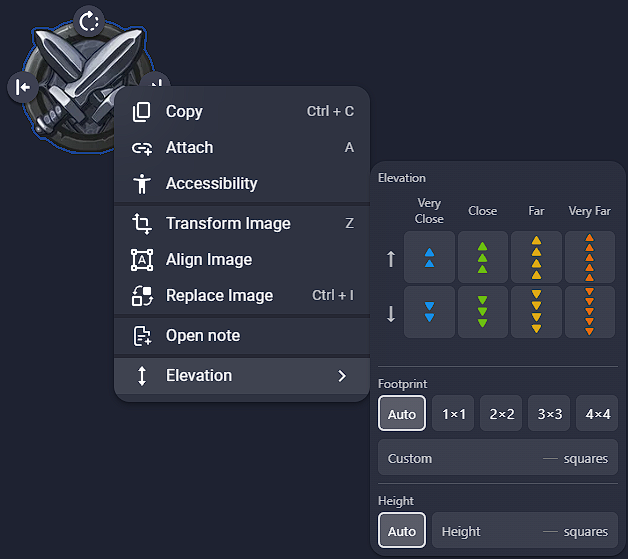

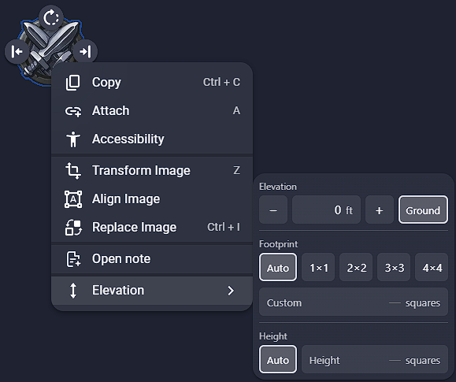

The same menu sets the token's **Footprint** — how many cells it takes up on the floor, from its image (*Auto*) or set by hand — and its **Height**, how tall it is, used when it's sunk below the floor.

## Isometric, dimetric and hex grids

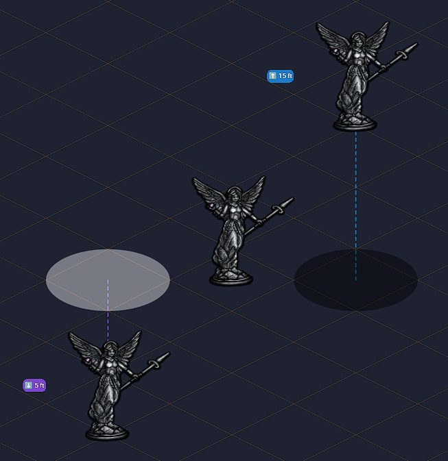

On hex grids the rings follow the cells: a range is every cell within that many steps, and a point picked near a cell's corner measures from the three cells around it. On isometric and dimetric grids, distances are measured on the floor the map shows, and each token from the cell it stands on.

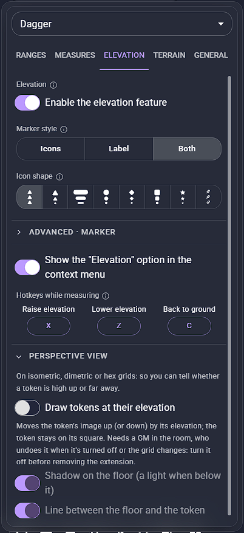

Under **Perspective view** in the Elevation tab, **Draw tokens at their elevation** moves each token's image up (or down) by its elevation, so you can tell a token that's high up from one that's far away; the token itself stays on its square. A shadow on the floor (a light when it's below it) and a line down to it show where it really stands. It needs a GM in the room, whose client moves the images: turn it off before removing the extension.

## Build your own ranges

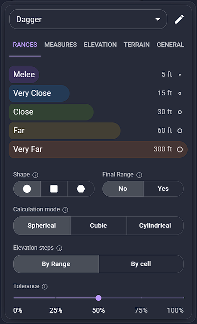

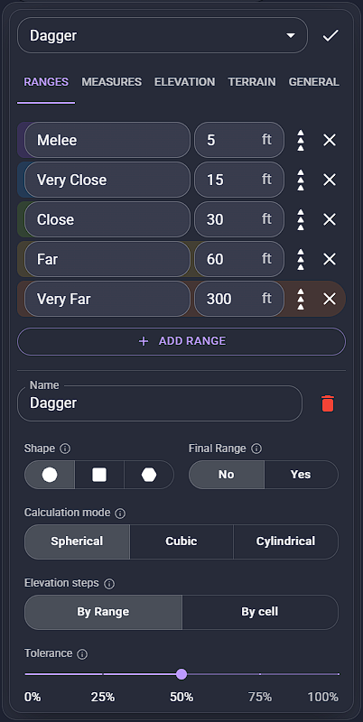

Start from Dagger, Steel, or Dragons — duplicate one to edit it — or build your own: name each range, set its radius and icon, add or delete ranges, and pick the rings' shape (circles, squares, or hexes on a hex grid), the calculation mode (spherical / cubic / cylindrical), whether elevations step by range or by cell, and how forgiving Tolerance is. Turn on a Final Range to give everything past the farthest range a name and color of its own, instead of "Out of range".

## What shows on the map

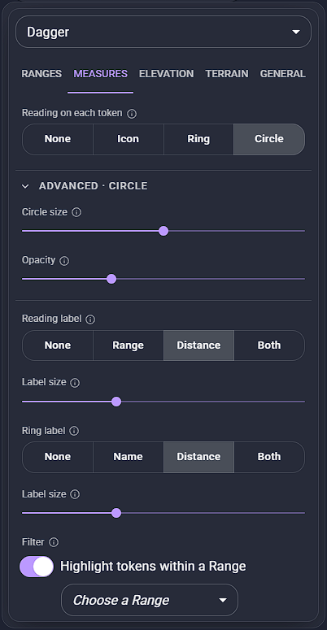

How each measured token is marked (an icon, a ring, a circle, or nothing), with its size and opacity under Advanced; what its label says (the Range, the exact distance, or both) and how big; what the rings around the Origin say, and how big; and an optional filter that highlights the tokens within a chosen Range. These are room settings, so they work with any set of ranges, presets included.

## Elevation

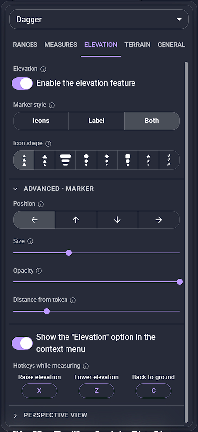

Turn the whole elevation feature on or off, show markers as icons, as a "⬆️ 30ft" label, or both, pick the icon shape, fine-tune the marker's position, size, opacity and distance under Advanced, and set the hotkeys that raise, lower or ground the Origin while measuring.

## Terrain

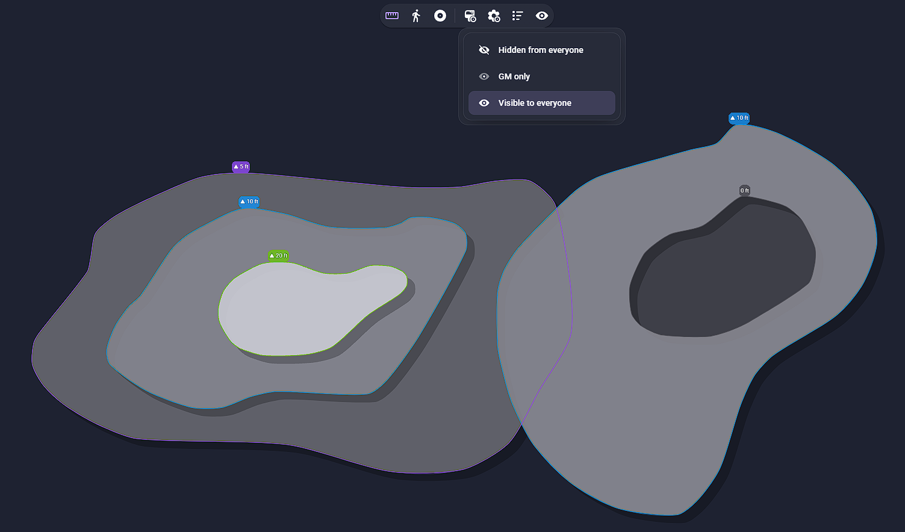

Give parts of the map an elevation: draw a rectangle, circle or polygon on the **Map** layer, right-click it and set its **Terrain elevation** (GM only). A token standing inside it — at its anchor, its feet once aligned — adds that elevation to its own when measuring, so an archer on a 30 ft tower is measured from 30 ft up without touching its marker. Where zones overlap, the smallest one wins, so a pit or a courtyard inside a plateau is the ground there.

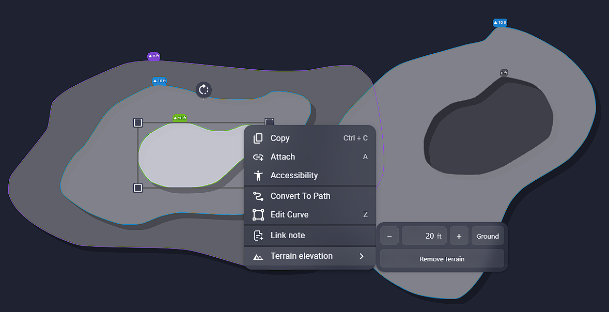

A toolbar button (GM only) picks who sees the terrain: nobody, only the GM, or everyone.

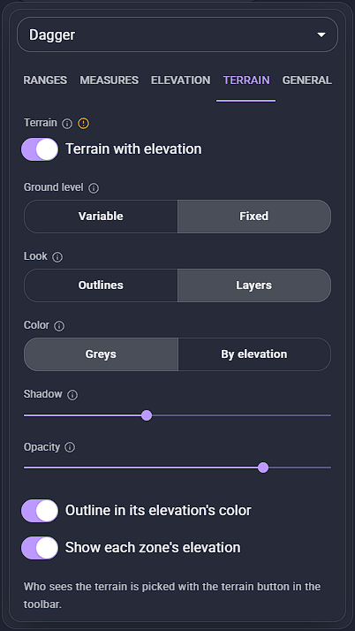

In the Terrain tab:

- **Ground level** chooses what elevations are shown from: above the terrain each token stands on (*Variable*), or above one fixed ground for the whole map, like sea level (*Fixed*). Distances are the same either way.
- **Look** draws zones as *Outlines* in the color of their elevation, or as *Layers*: filled like stacked cut paper, lighter the higher (or in their elevation's color), each casting a shadow on what's lower. Shadow, opacity, the outlines and each zone's elevation label can be tuned or turned off.
- Terrain can be turned off there too.

> **Meant for maps seen from above.** Terrain isn't used on isometric or dimetric grids: the art already shows the relief there, and a token drawn on a roof stands up the screen from where it really is on the floor. On hex maps drawn in perspective, the art's relief and the measured distances may not match.

## Distances panel


Pick or select a token to list every other one with its Range and its horizontal, vertical and total distance, live as tokens move. It stays open while you work on the map, and you can drag it anywhere on screen by its handle (double-click the handle to send it back to the corner). The GM decides whether it's for the GM only or for everyone; players never see hidden tokens, and the GM can hide them from their own list too (handy when sharing your screen).

## General

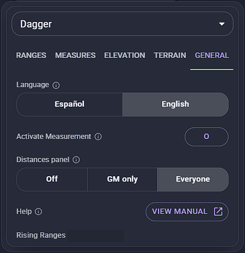

The room's language, the key that activates Measurement, who gets the Distances panel, and a Help button that opens this manual. Every setting applies right away — no reload needed — and their defaults keep the extension looking the way it always has until you change them.

## Color-blind themes


Pick Base or one of the three color-blind themes, or make a Custom one with up to 12 colors of your own. The theme is yours alone: everyone in the room sees the rings, Readings and elevation markers in the theme they picked, whoever is measuring.

## Installation

In Owlbear Rodeo, open the Extensions panel and add this manifest URL:

```
https://risingranges.ijpedraza.com/manifest.json
```

## About this fork

This project is a modified version of [Ranges](https://github.com/owlbear-rodeo/ranges) by Owlbear Rodeo, licensed under the GNU GPLv3. It merges Ranges' range-ring rendering with a relative elevation mechanic and a configurable 3D distance engine.

## License

GNU GPLv3 — see [`LICENSE`](./LICENSE).

## Support

Found a bug or have a feature request? Open an issue on [GitHub](https://github.com/nachoijp/Rising-Ranges/issues).

## Contributing

Not currently accepting outside contributions.

Copyright (C) 2024 Owlbear Rodeo
Copyright (C) 2026 Ignacio Pedraza (modifications)
