# 3D Glance

The 3D Glance shows the scene as a small diorama: the map's terrain raised to its heights, tokens standing at their elevation, range rings, distance lines and readings in 3D. The GM also builds the terrain here, with the relief editor.

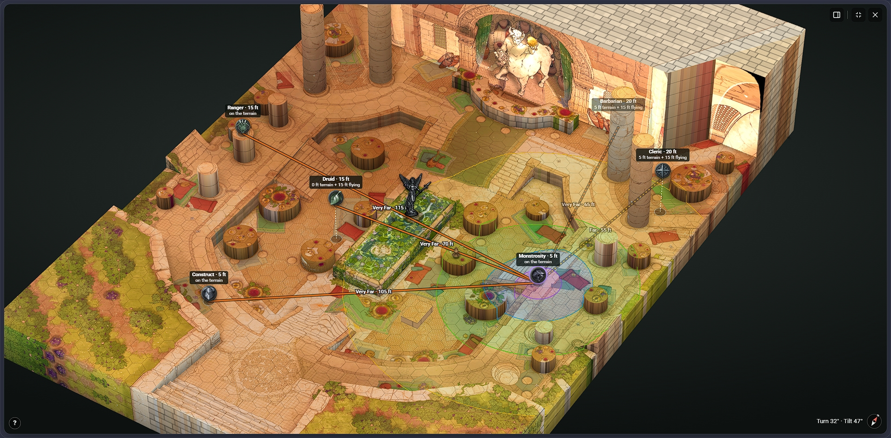

- [Opening it](#opening-it)
- [Moving around](#moving-around)
- [The panel](#the-panel)
- [Editing the relief](#editing-the-relief)
- [Shapes](#shapes)
- [Vertices and height points](#vertices-and-height-points)
- [Slabs](#slabs)
- [Groups](#groups)
- [Keyboard shortcuts](#keyboard-shortcuts)

## Opening it

The Glance has its own button in the toolbar. Who gets it is chosen in **Settings → General → 3D Glance**:

- **Hidden** — no button for anyone. The GM can still edit the relief from a map image's right-click menu.
- **GM only** — the default.
- **Everyone** — players open it too, and see the scene as their fog lets them.

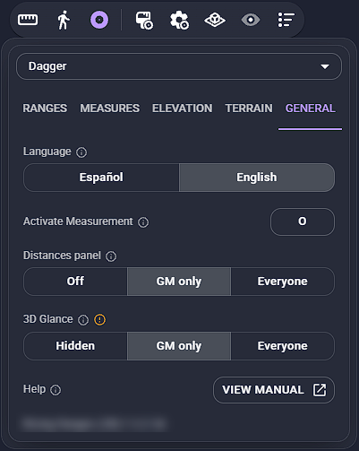

The window can be moved by its grip, minimised, or taken full screen. The panel on the right opens and closes with the button at its top.

The **camera** button beside it opens a list of camera moves — a full orbit round the terrain, a sweep, pushing in and out, a crane down from above, a pendulum — played once with the panel and buttons out of the way: a quick way to show the terrain. With **Sync view** on, the players see it too. Those marked ↻ end where they start, so they loop seamlessly if you record them. Esc or a click on the scene stops a move.

## Moving around

| Do | To |
| --- | --- |
| Drag | orbit around the middle |
| Hold the wheel, or Shift + drag | pan |
| Wheel | zoom |
| Double-click a token or the terrain | turn around that spot |
| Click the compass | reset the view |
| Click a token | select it |
| Drag a token | move it (Z / X change its height while dragging) |
| Click empty ground | measure from there (Z / X raise and lower the point) |
| Esc | remove the point, or close |

The **?** in the corner lists these too.

## The panel

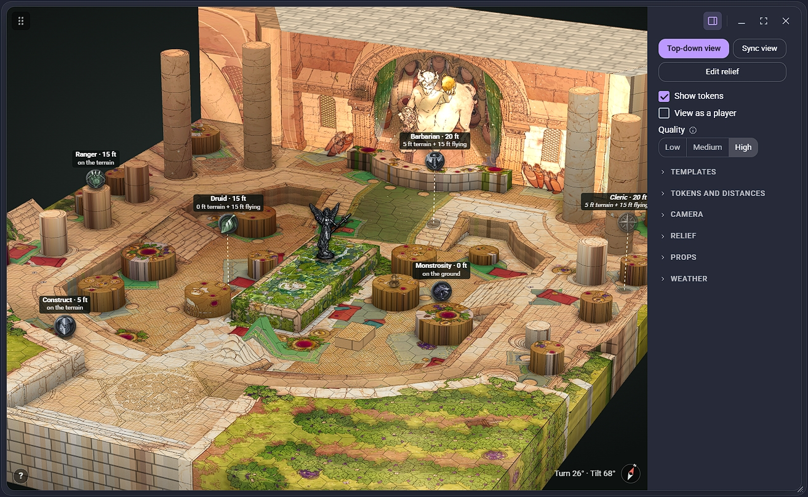

At the top:

- **Top-down view** — the camera straight down, as the map.
- **Sync view** (GM) — players with the Glance see what your camera sees (it opens for them if it's set to Everyone). Each still sees through their own fog.
- **Edit relief** (GM) — the relief editor (see below).
- **Show tokens** and **View as a player** — the scene as a player sees it: with the fog (Owlbear's or Smoke & Spectre's), without hidden tokens or what's under the fog.
- **Quality** — High as designed; Medium is a little less sharp on dense screens, with less weather; Low for slower devices.

The rest is folded into sections:

**Templates.** Spell areas in 3D: a sphere, cube, cylinder, cone or line, with a texture (fire, ice, poison, lightning, darkness, arcane, force, necrotic, acid, thunder, psychic, radiant) and a size. **Place**, then click where it goes; a cone or a line then points where you click. They're only in this view, and listed under the buttons to remove one by one.

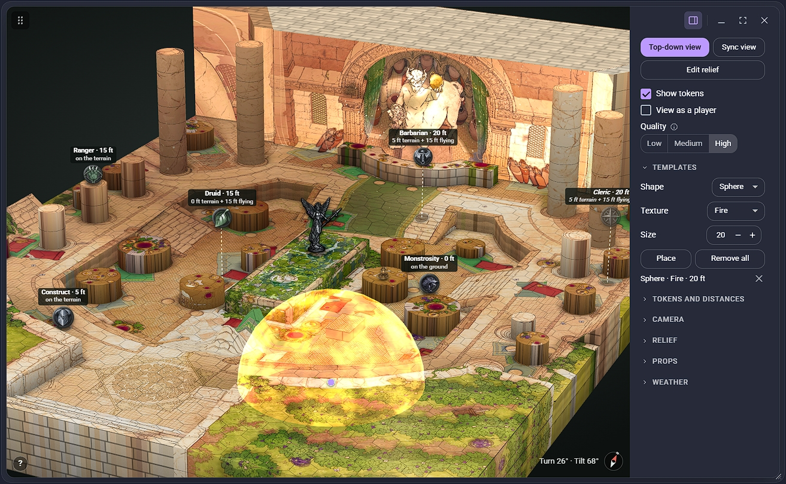

**Tokens and distances.** The point of a token that's measured (its center or its base), distance lines, range rings on the terrain, the ground tinted by range, and how much the labels say.

**Camera.** Tilt, turn, and perspective (from flat to strong), and a reset.

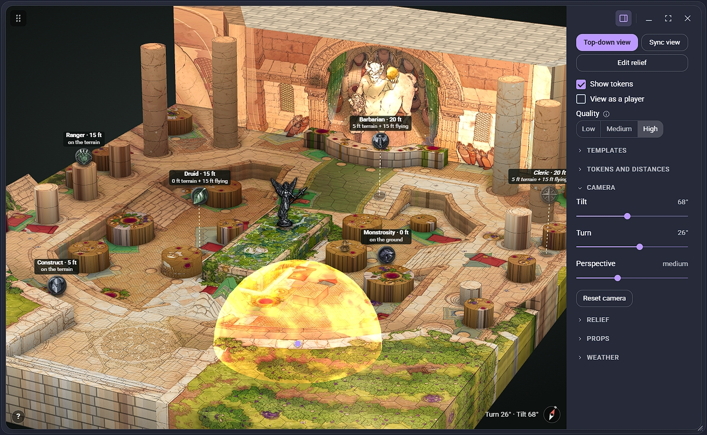

**Relief.** The height scale (to make heights read better), walls at the map's edge, the grid on the ground, and under **Look**: wall shading, shading by height, coloring the terrain by height, see-through terrain, animated water, animated video maps (a video map played on the ground), and level lines on the walls.

**Props.** Items on the Prop layer, on the ground or standing, with shadows, lines to the ground, labels and distances.

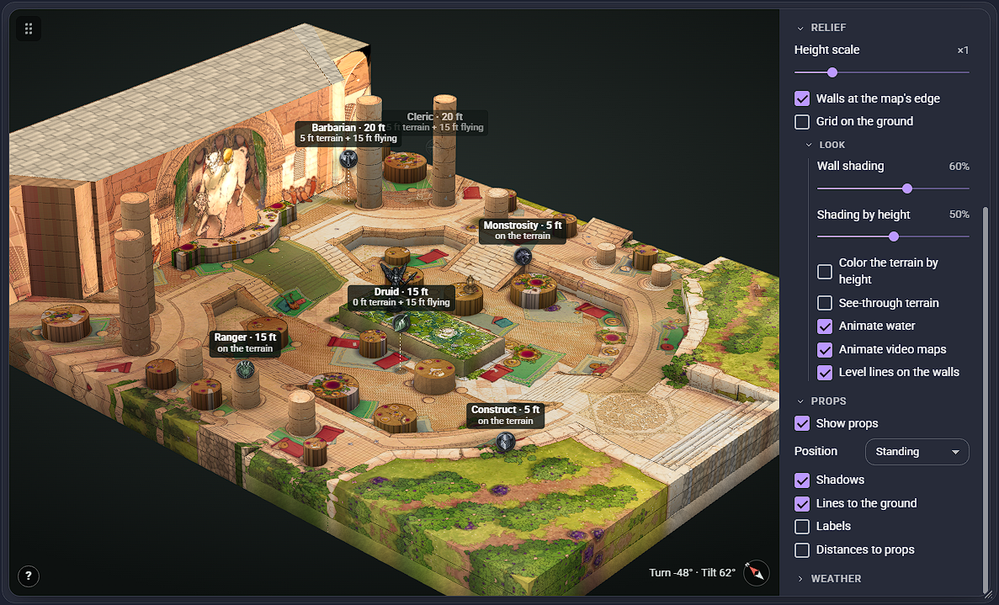

**Weather.** Rain, snow, sand, fire, petals or clouds from the Weather extension, if the scene has any; clouds as mist or as shadows on the ground.

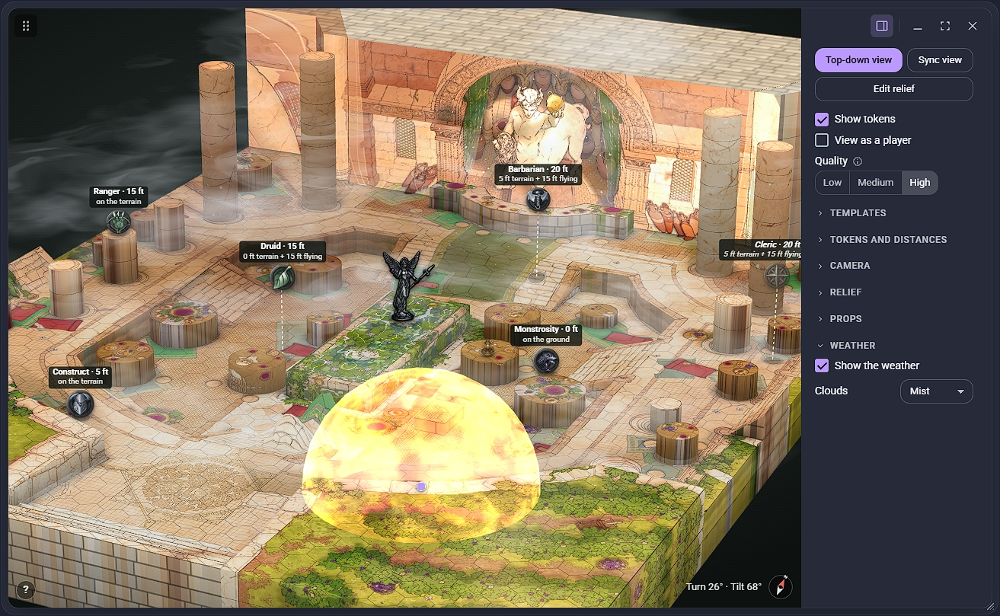

## Editing the relief

**Edit relief** (or **Edit relief** in a map image's right-click menu) opens the editor full screen: the map on the left, the 3D on the right. The line between them can be dragged; past a point, either side folds away.

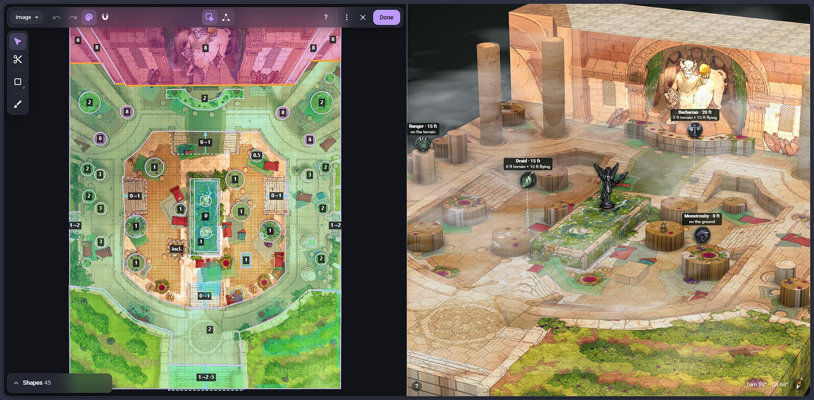

The relief follows the map image: move or resize the map, and it goes with it. If the scene has several maps, the one being edited is picked at the top left. **Done** saves; the **X** leaves without saving (a second click if there are changes). Under **⋮**: export the relief to a file, import one, bring in the zones from the old terrain tool, or clear it.

The tools, on the left:

- **Select** — pick shapes and move, resize or turn them; or, in **Vertices** mode, their corners and height points (see [Vertices and height points](#vertices-and-height-points)).
- **Cut** — drag a line across a shape to split it in two.
- **Draw** — the shape tools, in one button:

  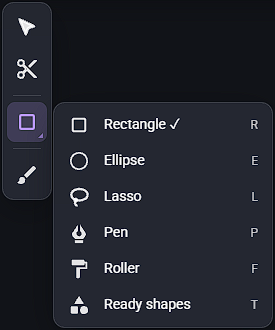

  - **Rectangle** and **Ellipse** — drag from corner to corner (Shift: a square or circle; Alt: from the middle).
  - **Lasso** — draw the outline freehand (its smoothing in the bar).
  - **Pen** — click each corner; click the first one (or Enter) to close it.
  - **Roller** — paint over what you want to trace; let go, and it's a shape. Touching the picked shape, it grows it; with Alt, it cuts from it.
  - **Ready shapes** — a column, a pit, stairs, a platform with a ramp, a wall or a mound, put down with a click.

  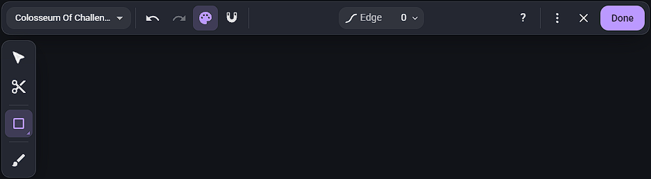

  The **Edge** in the bar is the edge new shapes get: a wall (0), or a soft slope that fades into what's round it.

- **Terrain brush** — raises, lowers, smooths or flattens what's on top (the ground, or the shape over it), or only the ground. Its size and strength are in the bar; [ and ] change its size while painting.

  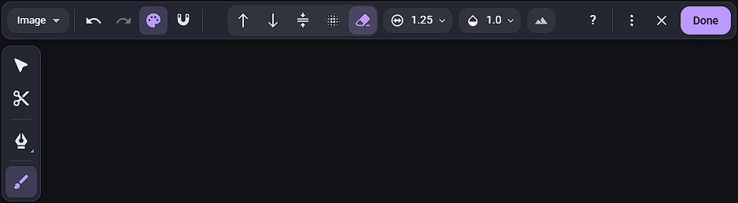

The **magnet** snaps to the grid; the **palette** colors the map by height.

## Shapes

Shapes are stacked: each one sits on what's under it. Picking one shows its panel:

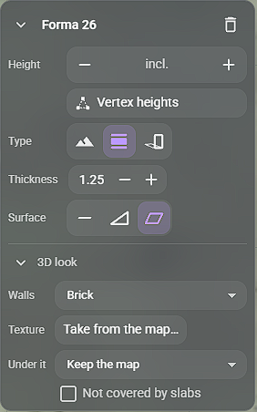

- **Height** — a level over what's under it (**relative**), or a height of its own (**fixed**, the pin under **Measured**).
- **Type** — **Terrain** (ground you can stand on), **Slab** (a bridge, balcony or platform floating over the terrain: see [Slabs](#slabs)), or **Standing** (the map's picture of it stood upright, as a statue or a tree).
- **Surface** — **Flat**, a **Ramp** (an arrow from one height to another, in steps if you want stairs), or **Inclined** (each corner at its own height).
- **3D look** — its walls' look: **Blend** (the default: the map's colors along the wall, the top's running into the foot's, with a subtle grain), **Flat color**, **Stretched edge** and **Folded edge** (the map's edge pulled down the wall), **Brick**, **Stone**, **Earth** or **Wood**; a texture taken from a rectangle of the map; water in it; its edge (a wall, or a soft slope); and **Not covered by slabs** (see [Slabs](#slabs)).

Right-click a shape for duplicate, rename, layer up or down, convert, combine (union, subtract, intersect, exclude), group, take a texture, or delete.

## Vertices and height points

In **Vertices** mode (the second button in Select's bar, or double-click a shape), the picked shape's corners and height points can be moved:

- **Click a side** — adds a corner there (a "+" shows where), ready to drag into place.
- **Double-click inside an inclined shape** — adds a height point: a spot of its surface at its own height. The hint at the bottom of the map says how, wherever the pointer is.
- **Alt + click** a corner or point — removes it.
- **Drag on empty space** — picks several corners and points with a box; **Shift + click** adds one or takes it out.
- **Z / X**, or − / + in the panel, raise and lower what's picked by a quarter level; arrow keys nudge it; Delete removes it.

An inclined shape's surface goes through every corner and height point, in triangles between the nearest ones. A point lower than the ones round it makes a dip; two high points with a lower one between them, a channel.

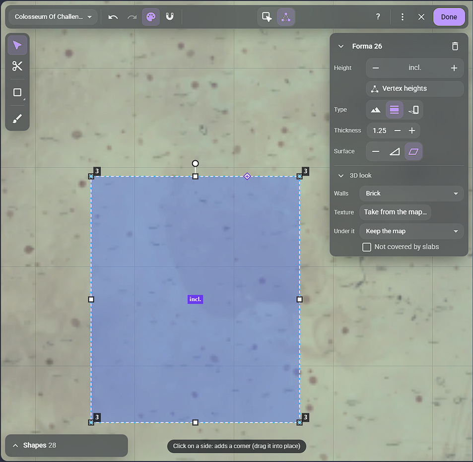

## Slabs

A slab floats over the terrain at its height, as thick as its **Thickness**. Inclined or ramped, it follows its surface. Tokens can stand on it, and it blocks sight.

The map usually shows the slab from above, so under it the 3D would repeat its drawing on the ground. **Under it** picks what's shown there instead:

- **Cover the drawing** (the default) — the map's colors round it, blended, with a grain.
- **Mirror the sides** — the map by its long sides, mirrored: for a bridge over a river or a road.
- **Keep the map** — nothing: for a slab that isn't drawn on the map.

A shape under a slab that should keep its own look — a pillar under a statue — gets **Not covered by slabs** in its 3D look.

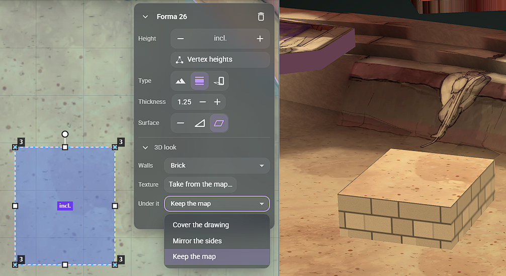

## Groups

Shapes can be grouped, as folders in the shapes list: **Ctrl + G** (or the right-click menu) groups the picked ones; **Ctrl + Shift + G** undoes a group. Groups can hold groups.

- A group's shapes always stay together in the stacking order, so their order inside it stays as it is.
- Click a group to pick all its shapes; drag it to move it whole; drop something on its lower half to put it in.
- Its eye and lock hide or lock all its shapes at once (in the editor only).
- A new shape drawn while a grouped shape is picked goes into that group.

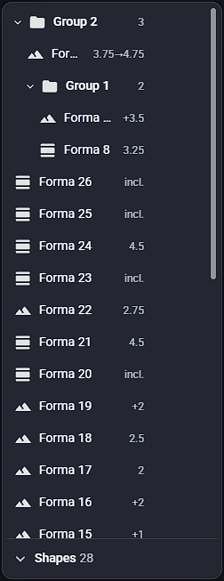

## Keyboard shortcuts

| Key | Does |
| --- | --- |
| V | Select (again: shapes / vertices) |
| Ctrl + Z / Ctrl + Y | undo / redo |
| Ctrl + D | duplicate |
| Ctrl + G / Ctrl + Shift + G | group / ungroup |
| F2 | rename the shape |
| [ and ] | a layer down or up (with the brush: its size) |
| Z / X | raise / lower what's picked |
| Arrow keys | nudge |
| Delete | delete |
| Esc | let go |

Each tool's own keys are in its tooltip and in the **?** at the top.
